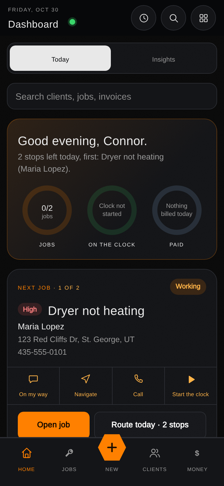

# Triple H Enterprises


[](https://github.com/carwash2020/webpagehosting/actions/workflows/test.yml)
[](https://github.com/carwash2020/webpagehosting/actions/workflows/check-links.yml)

**The website, client portal and back-office app for Triple H Enterprises LLC,
a handyman and appliance repair business in St. George, Utah.**

Live at **[www.triplehenterprisesllc.biz](https://www.triplehenterprisesllc.biz)**.
One static repo serves three things from that domain:

| Surface | Path | Who it's for |
|---|---|---|
| **Public site** | `/` (repo root) | Customers and search engines |
| **Client portal** | `/portal/` | Existing clients |
| **Workspace** | `/tools/` | The business owner and staff (internal, `noindex`) |

<p align="center">
  
  <br>
  <sub>Workspace Home on a phone (seeded demo data)</sub>
</p>

## Features

### Public site
- Homepage with service overview, reviews, service-area map and an above-the-fold estimate form.
- **Landing pages** for each service (`/services/`), service-by-city pairs (washer/dryer, refrigerator and dishwasher repair in St. George), and each town served (`/locations/`).
- **In-house online booking** (`booking.html`): pick a service, a real open slot and enter contact details. A database exclusion constraint prevents double-booking. Guests cancel or reschedule from a tokenized link (`manage-booking.html`, `manage-job.html`).
- A blog of 16 repair guides, with Article structured data.
- SEO and answer-engine groundwork: per-page metadata, JSON-LD (LocalBusiness, Service, FAQPage), sitemap, a differentiated `robots.txt`, and Open Graph cards for every page.
- A GA4 cookie-consent banner using Google Consent Mode v2.
- Owner-editable content (rating, banners, hours, FAQ, Terms) published from the Workspace without a deploy.

### Client portal (`/portal/`)
- Invite-based accounts: a client sets a password from an emailed invite, then signs in.
- **Quotes**: review, ask questions, approve and self-schedule.
- **Invoices**: view and pay by card through Stripe, with saved cards.
- **Jobs**: history, warranty and check-up reminders.
- **Work orders**: request work and message the business two ways.
- **Contracts**: review and respond.
- Notification preferences and push notifications.
- **Referral program**: every client gets a shareable referral code.

### Workspace (`/tools/`)
An installable, phone-first app for running the business:

- **Dashboard** (`workspace.html`): today's next job, money owed, and a "Needs attention" inbox for leads, bookings, work requests and unpaid invoices.
- **Jobs** (`job-tracker.html`, `job-detail.html`): list, board and calendar views, a job clock, photos, and one tap from "done" to an invoice.
- **Clients** (`clients.html`, `client-detail.html`): full history per client, with duplicate detection.
- **Invoices and quotes** (`invoice-generator.html`): branded PDFs, quote-to-invoice conversion, and Quick charge for card payments on the spot.
- **Finance** (`tools/finance.html`): expenses with receipts, income, and profitability.
- **Runway Dashboard**, **Contract Generator**, **Route Planner**, **Review Request Sender** and the **Appliance Wiki** (`parts-reference.html`).
- **Site Content** (`site-content.html`): edit the public site's changeable text, with history and undo, and review the gallery queue.
- **Settings** (theme, notifications, MFA, backup and restore) and **Dev Tools** (role-gated diagnostics: health, data integrity, sync, notifications, ops, reports, access).
- Cross-device sync through Supabase, with per-record merge, deletion tombstones and a restorable Graveyard.
- Two-factor sign-in for internal accounts, enforced server-side for every table, bucket and edge function once an authenticator is set up.

### Automation
- Email and push notifications for bookings, leads, quotes, invoices, payment and appointment reminders, and job status changes (Resend for email, Web Push for push).
- Scheduled jobs in Supabase `pg_cron`: daily business checks and a weekly digest.
- GitHub Actions: tests on every push, nightly backups, uptime checks every 10 minutes, link checks, Lighthouse scoring, edge-function drift detection, and automatic cache-bust fixes.

## Tech stack

| Layer | What's used |
|---|---|
| Frontend | Hand-written HTML, CSS and vanilla JavaScript. **No framework and no build step.** |
| Hosting | GitHub Pages, custom domain via `CNAME` |
| Backend | [Supabase](https://supabase.com): Postgres with row-level security, Auth, Storage, Realtime, `pg_cron` |
| Server code | Supabase Edge Functions (TypeScript on Deno), with source snapshots in `edge-functions/` |
| Payments | Stripe (Payment Intents, saved cards, webhooks) |
| Email | Resend |
| Client-side libraries | supabase-js, jsPDF, Stripe.js, loaded per page |
| Tooling (dev only) | Node.js test runner, jsdom, PGlite (in-process Postgres for SQL tests), ESLint, Python 3 link checker |

## Repository layout

```
.
├── index.html, booking.html, …   Public site pages (kept at the root so live URLs never change)
├── services/                     Service and service-by-city landing pages
├── locations/                    City landing pages (plus redirect stubs for retired URLs)
├── blog/                         Blog index and posts
├── js/, styles.css, images/      Public-site scripts, stylesheet and media
├── portal/                       Client portal (shares no JavaScript with tools/)
├── tools/                        Workspace app: pages, sync engine, shared tool scripts
│   ├── sync.js, data-layer.js    Cloud sync and the shared read/write path
│   └── tools-effects.js, tools-dialogs.js, tools-media-sharing.js, tools-nav-pwa.js
├── service-worker.js             PWA service worker (root scope covers the whole site)
├── edge-functions/               Source of every deployed Supabase Edge Function
├── sql/                          Every schema change and migration run against Supabase, by feature
├── tests/                        Node test suite, by area (booking, portal, security, sync, …)
├── scripts/                      Consistency, link, lint-adjacent and backup scripts
├── backups/                      Nightly CMS content backup (public data only)
├── docs/                         Project docs, changelog, logs and screenshot harnesses
└── .github/workflows/            CI, backups, monitoring
```

## Getting started

Requirements: Node.js 22.22+ or 24.15+, Python 3. Nothing else is needed to
work on the site itself, since every page is a static file.

```bash
npm install            # dev-only tooling; the deployed site has no dependencies

npm test               # full test suite (~4,600 tests, a few minutes)
npm run verify         # everything below, then the test suite: run before every push

npm run check-consistency     # cache-bust stamps, service-worker precache list, cross-file rules
npm run fix-versions          # rewrite every ?v= stamp to the file's real content hash
npm run check-undefined-vars  # catch references to undefined globals in inline scripts
npm run check-links           # internal links/assets everywhere, external links on public pages
npm run lint                  # ESLint
```

To preview locally, serve the repo root with any static server, for example
`python3 -m http.server 8000`, then open `http://localhost:8000`. The portal and
Workspace talk to the live Supabase project using its public anon key.

**If you edit a CSS or JS file loaded by more than one page, run
`npm run fix-versions` before committing.** CI fails otherwise.

## Deployment

- **Website:** merging to `main` is the deploy. GitHub Pages publishes the repo
  root as-is (`.nojekyll` keeps dot-paths such as `.well-known/` served). `main`
  is protected: changes land by pull request after the `test` check passes.
- **Edge Functions:** merging a change under `edge-functions/` does *not* deploy
  it. Deploy with the Supabase CLI or dashboard. The **Edge function drift**
  workflow then fails until the live function matches the repo.
- **Database:** files in `sql/` are a record of what was run, applied by hand
  or through Supabase migrations. Read each file's header before re-running
  it: some are one-time fixes.
- **Secrets** (Stripe, Resend, service-role keys) live only in Supabase and
  GitHub Actions secrets, never in this repo.

Read the deploy pitfalls in [`docs/REFERENCE.md`](docs/REFERENCE.md#️-read-this-before-touching-deployment-at-all)
before changing hosting config. That section also covers how to verify what is
actually live.

## Documentation

| Doc | What's in it |
|---|---|
| [`docs/GETTING-STARTED.md`](docs/GETTING-STARTED.md) | Reading order and how to verify a change is safe |
| [`docs/REFERENCE.md`](docs/REFERENCE.md) | What every file is for, plus sync, booking, automation, cache-busting, and the **Do not delete** list |
| [`docs/CHANGELOG.md`](docs/CHANGELOG.md) | Dated history of every change, newest at the bottom |
| [`docs/ACTION-ITEMS.md`](docs/ACTION-ITEMS.md) | Open to-dos and manual steps |
| [`docs/CLIENT-PORTAL.md`](docs/CLIENT-PORTAL.md) | Client portal architecture, tables and functions |
| [`docs/ARCHITECTURE-NOTES.md`](docs/ARCHITECTURE-NOTES.md) | Architectural backlog and decisions already made |
| [`docs/GLOSSARY.md`](docs/GLOSSARY.md) | Project-specific terms (tombstone, graveyard, padded_range, …) |
| [`DISASTER_RECOVERY.md`](DISASTER_RECOVERY.md) | Incident runbooks and backup/restore |
| [`SECURITY.md`](SECURITY.md) | Security model and how to report an issue |
| [`CONTRIBUTING.md`](CONTRIBUTING.md) | How changes are made here |
| [`docs/specialist-logs/`](docs/specialist-logs/) | Working notes per area (visual, bugfix, security, …) |

## Changelog

The full dated history lives in **[`docs/CHANGELOG.md`](docs/CHANGELOG.md)**.
New entries go at the bottom of that file, not here.

## License

Copyright (c) 2026 Triple H Enterprises LLC. All rights reserved. See [`LICENSE`](LICENSE).
