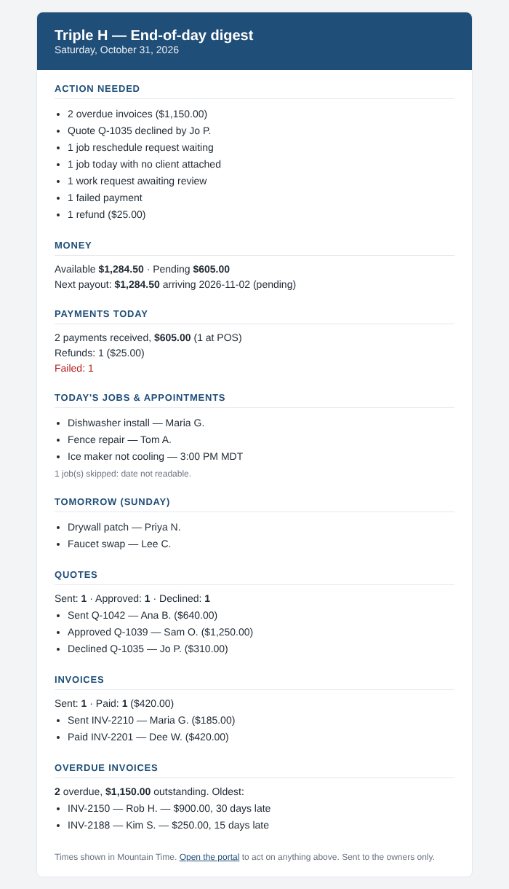

# Daily end-of-day digest

Edge function `daily-digest` emails the owners one summary each evening.
**It ships disabled. Merging the PR sends nothing, applies nothing, deploys nothing.**



Sample data only; regenerate with `node scripts/render-daily-digest-sample.js`.

## How to enable (in order)

1. **Apply the migration** `sql/infra/add_daily_digest.sql` (creates `digest_settings` and `digest_runs`, RLS on, seeds one row with `enabled=false` and no recipients). Additive only.
2. **Deploy** `edge-functions/daily-digest-index.ts` as function `daily-digest`, **verify_jwt = true** (the code also requires the service-role key as the bearer token). It reuses the existing edge secrets `STRIPE_SECRET_KEY`, `RESEND_API_KEY` and `LEAD_EMAIL_FROM`. No new secrets.
3. **Set recipients** (never put emails in code):
   ```sql
   update digest_settings
   set recipients = array['<connor address>', '<steve address>']
   where id = 1;
   ```
   Optionally set `from_address` (must be on a Resend-verified domain; otherwise `LEAD_EMAIL_FROM` is used).
4. **Dry run** (sends nothing, works while disabled): POST `{"dry_run": true}` to the function with the service-role bearer token. It returns `html`, `text`, `subject`, `counts`. Check the "Stripe mode" banner is absent (live key) and the numbers look right.
5. **Enable**: `update digest_settings set enabled = true where id = 1;`
6. **Schedule**: apply `sql/infra/add_daily_digest_cron.sql` (hourly; the function only sends in the local send window). It is safe to apply before step 5, since the function returns while disabled.

To turn it off again: `update digest_settings set enabled = false where id = 1;` (or `select cron.unschedule('daily-digest-hourly');`).

## Behavior

- Local date and send hour use `digest_settings.timezone` (America/Denver). The cron fires hourly; the function sends when local hour is in `[send_hour_local, send_hour_local + 3]`, so a failed 8 PM send retries at 9, 10, 11 PM. Otherwise returns 204.
- Idempotency: one `digest_runs` row per local date. Sent/skipped exits; pending under 10 minutes exits; failed retries up to 3 attempts. Resend gets `Idempotency-Key: daily-digest-<date>`. A third failure writes one `cron_alerts` row (`job_run_failed`).
- Each section loads independently: Stripe down shows "Stripe unavailable", a failing table shows "Unavailable", and the rest still send.
- Empty day: sends a short "Quiet day" email (balance, payout, tomorrow, overdue) unless `send_on_empty_day = false`, which marks the run `skipped`.
- Privacy: logs hold counts, date, status and Resend id only. The body uses "First L." names and invoice/quote numbers; no addresses or phones. `digest_runs.counts` has no names or emails.
- `{"force": true}` skips the hour guard (still honors `enabled` and idempotency).

## Resolved from the spec's "unverified" list

| Item | Finding |
|---|---|
| Quote statuses | `pending` / `approved` / `declined` (`respond-to-quote`). There is no "changes requested" status, so the digest shows Sent / Approved / Declined. |
| Work-order statuses | `submitted`, `reviewing`, `quoted`, `scheduled`, `completed`, `declined`, `cancelled`. Action needed = `submitted` or `reviewing`. |
| Invoice terms | `Due Upon Receipt` / `Net 15` / `Net 30`; unknown falls back to **15 days** (same as `send-payment-reminder`), not the spec's 30. |
| `cron_alerts` | Columns `alert_type`, `detail`, ...; `alert_type` is check-constrained to `job_run_failed` / `http_response_failed`, so the digest uses `job_run_failed` rather than altering the constraint. |
| `account_roles` | Role column is `role_name`; the settings policy only needs the email match, so it is not role-restricted. |
| Resend secret / sender | `RESEND_API_KEY` and `LEAD_EMAIL_FROM` (same as `create-pos-charge`). |
| Vault secret | `send_push_service_role_key`. |
| Stripe key | `STRIPE_SECRET_KEY` is used per the spec (the request says keys are live). The digest shows a TEST banner if `livemode` is false. |
| Job and invoice dates | Parsed defensively (`YYYY-MM-DD` or `M/D/YYYY`); unreadable job dates are skipped and counted in the email. |

## Known limits

- Tenant filter (`tenant_id` match or null) applies to `jobs` and `invoices`. The portal tables are not filtered by tenant.
- `client_portal_work_orders.scheduled_at` is taken from the spec's schema check; if that column is absent, that section shows "Unavailable".
- The Stripe "failed" count includes canceled intents and `requires_payment_method` intents that carry a payment error.
- `edge-function-drift.yml` will flag the new function as undeployed after merge until step 2 is done.
